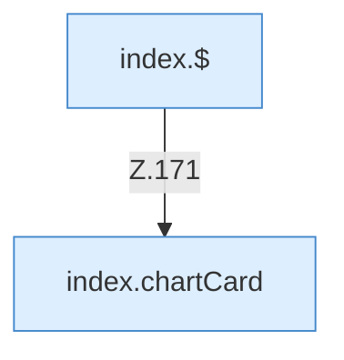

[[00 Start]] › [[Dashboard-UI]] › [[Legacy-Status]] › [[index.updateCharts]] › [[index.updateCharts.Teil2]]

# index.updateCharts.Teil2



```knoten
index.$
  Sucht auf der älteren [[Glossar#Bedienseite|Bedienseite]] ein einzelnes Element. `$` in `index.html`.
index.chartCard
  Baut in der älteren [[Glossar#Bedienseite|Bedienseite]] eine Karte mit einer Kurve. Zeichnet das Diagramm `chartCard`. Ruft `x`, `y`.
```

> [!knoten]- Was die Blöcke tun
> - **index.$**: Sucht auf der älteren [[Glossar#Bedienseite|Bedienseite]] ein einzelnes Element. `$` in `index.html`.
> - **index.chartCard**: Baut in der älteren [[Glossar#Bedienseite|Bedienseite]] eine Karte mit einer Kurve. Zeichnet das Diagramm `chartCard`. Ruft `x`, `y`.

- Ein weiterer Abschnitt derselben Übersicht.
- Fortsetzung von `index.updateCharts`.
