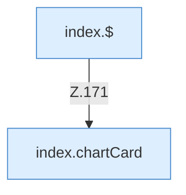

[[00 Start]] › [[Dashboard-UI]] › [[Legacy-Status]] › [[index.updateCharts]] › [[index.updateCharts.Teil2]]

# index.updateCharts.Teil2



```knoten
index.$
  `$` in `index.html`.
index.chartCard
  Zeichnet das Diagramm `chartCard`. Ruft `x`, `y`.
```

- Fortsetzung von `index.updateCharts`, Quellreihenfolge.
