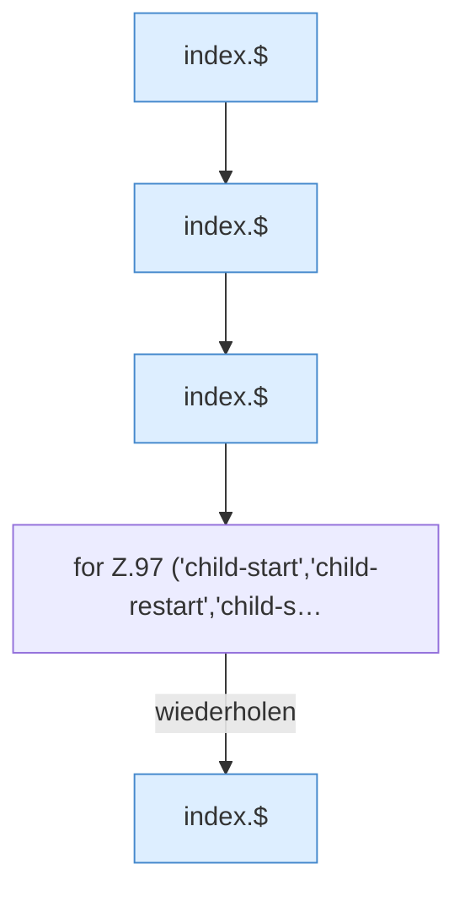

[[00 Start]] › [[Dashboard-UI]] › [[Legacy-Status]] › [[index.updateChildActions]] › [[index.updateChildActions.Teil1]]

# index.updateChildActions.Teil1

- Fortsetzung von `index.updateChildActions`, Quellreihenfolge.
