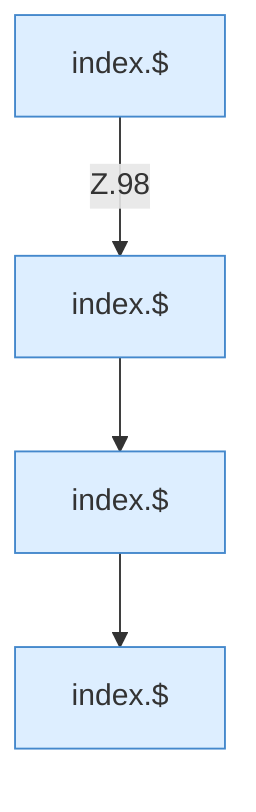

[[00 Start]] › [[Dashboard-UI]] › [[Legacy-Status]] › [[index.updateChildActions]] › [[index.updateChildActions.Teil2]]

# index.updateChildActions.Teil2



```knoten
index.$
  Sucht auf der älteren [[Glossar#Bedienseite|Bedienseite]] ein einzelnes Element. `$` in `index.html`.
```

> [!knoten]- Was die Blöcke tun
> - **index.$**: Sucht auf der älteren [[Glossar#Bedienseite|Bedienseite]] ein einzelnes Element. `$` in `index.html`.

- Ein weiterer Abschnitt derselben Übersicht.
- Fortsetzung von `index.updateChildActions`.
