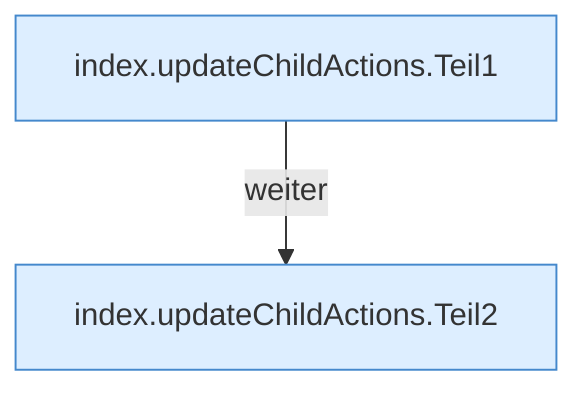

[[00 Start]] › [[Dashboard-UI]] › [[Legacy-Status]] › [[index.updateChildActions]]

# index.updateChildActions

`index.updateChildActions(s)` [src/main/resources/web/index.html:93–100](https://github.com/Sciddie/minecraft-serverhoster-plugin/blob/95b02b953b0b4c23673e900e021a7c3c844aa37d/src/main/resources/web/index.html#L93-L100)



```knoten
index.updateChildActions.Teil1
  Ein weiterer Abschnitt derselben Übersicht. Im [[Glossar#Quelltext|Quelltext]] heißt das `Teil1`.
index.updateChildActions.Teil2
  Ein weiterer Abschnitt derselben Übersicht. Im [[Glossar#Quelltext|Quelltext]] heißt das `Teil2`.
```

> [!knoten]- Was die Blöcke tun
> - **index.updateChildActions.Teil1**: Ein weiterer Abschnitt derselben Übersicht. Im [[Glossar#Quelltext|Quelltext]] heißt das `Teil1`.
> - **index.updateChildActions.Teil2**: Ein weiterer Abschnitt derselben Übersicht. Im [[Glossar#Quelltext|Quelltext]] heißt das `Teil2`.

- Die ältere [[Glossar#Bedienseite|Bedienseite]] ändert den [[Glossar#Spielserver|Spielserver]] die Tätigkeiten.
