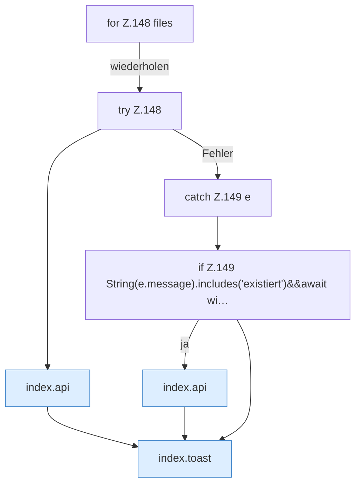

[[00 Start]] › [[Dashboard-UI]] › [[Legacy-Dateien]] › [[index.upload]] › [[index.upload.Z148]]

# index.upload.Z148



```knoten
for Z.148 files
  Zeile 148: Schleife `files`.
try Z.148
  Zeile 148: Versuch. Der Fehlerpfad geht in catch.
index.api
  Schickt von der älteren [[Glossar#Bedienseite|Bedienseite]] eine Anfrage an die [[Glossar#Web-Schnittstelle|Web-Schnittstelle]]. Sendet einen Dashboard-Request `api`. Ruft `scoped`, `showLogin`, `toast`.
catch Z.149 e
  Zeile 149: fängt e.
if Z.149 String(e.message).includes('existiert')&&await wi…
  Zeile 149: prüft `String(e.message).includes('existiert')&&await wi…`.
index.toast
  Zeigt in der älteren [[Glossar#Bedienseite|Bedienseite]] einen kurzen Hinweis. Zeigt eine Meldung `toast`. Ruft `$`.
```

> [!knoten]- Was die Blöcke tun
> - **for Z.148 files**: Zeile 148: Schleife `files`.
> - **try Z.148**: Zeile 148: Versuch. Der Fehlerpfad geht in catch.
> - **index.api**: Schickt von der älteren [[Glossar#Bedienseite|Bedienseite]] eine Anfrage an die [[Glossar#Web-Schnittstelle|Web-Schnittstelle]]. Sendet einen Dashboard-Request `api`. Ruft `scoped`, `showLogin`, `toast`.
> - **catch Z.149 e**: Zeile 149: fängt e.
> - **if Z.149 String(e.message).includes('existiert')&&await wi…**: Zeile 149: prüft `String(e.message).includes('existiert')&&await wi…`.
> - **index.toast**: Zeigt in der älteren [[Glossar#Bedienseite|Bedienseite]] einen kurzen Hinweis. Zeigt eine Meldung `toast`. Ruft `$`.

- Der Ablauf geht in [[Glossar#Zeile|Zeile]] 148 weiter. Eine Ebene tiefer steht er genauer.
- Fortsetzung von `index.upload`.
