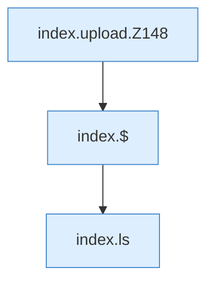

[[00 Start]] › [[Dashboard-UI]] › [[Legacy-Dateien]] › [[index.upload]]

# index.upload

`index.upload(files)` [src/main/resources/web/index.html:148–149](https://github.com/Sciddie/minecraft-serverhoster-plugin/blob/95b02b953b0b4c23673e900e021a7c3c844aa37d/src/main/resources/web/index.html#L148-L149)



```knoten
index.upload.Z148
  Der Ablauf geht in [[Glossar#Zeile|Zeile]] 148 weiter. Eine Ebene tiefer steht er genauer. Im [[Glossar#Quelltext|Quelltext]] heißt das `Z148`.
index.$
  Sucht auf der älteren [[Glossar#Bedienseite|Bedienseite]] ein einzelnes Element. Im [[Glossar#Quelltext|Quelltext]] heißt das `$`.
index.ls
  Zeigt in der älteren [[Glossar#Bedienseite|Bedienseite]] den Inhalt eines Ordners. Im [[Glossar#Quelltext|Quelltext]] heißt das `ls`.
```

> [!knoten]- Was die Blöcke tun
> - **index.upload.Z148**: Der Ablauf geht in [[Glossar#Zeile|Zeile]] 148 weiter. Eine Ebene tiefer steht er genauer. Im [[Glossar#Quelltext|Quelltext]] heißt das `Z148`.
> - **index.$**: Sucht auf der älteren [[Glossar#Bedienseite|Bedienseite]] ein einzelnes Element. Im [[Glossar#Quelltext|Quelltext]] heißt das `$`.
> - **index.ls**: Zeigt in der älteren [[Glossar#Bedienseite|Bedienseite]] den Inhalt eines Ordners. Im [[Glossar#Quelltext|Quelltext]] heißt das `ls`.

- Schickt eine Datei von der älteren [[Glossar#Bedienseite|Bedienseite]] an das [[Glossar#Plugin|Plugin]].
