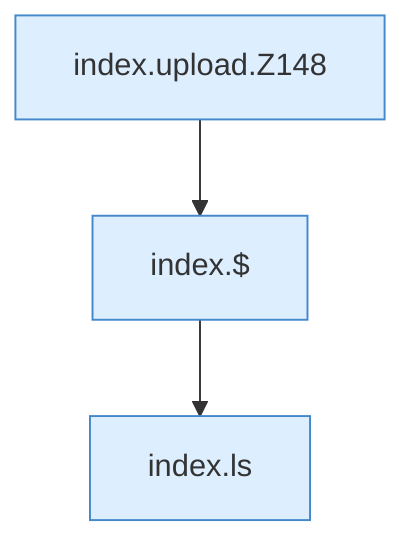

[[00 Start]] › [[Dashboard-UI]] › [[Legacy-Dateien]] › [[index.upload]]

# index.upload

`index.upload(files)` [src/main/resources/web/index.html:148–149](https://github.com/Sciddie/minecraft-serverhoster-plugin/blob/95b02b953b0b4c23673e900e021a7c3c844aa37d/src/main/resources/web/index.html#L148-L149)



```knoten
index.upload.Z148
  Fortsetzung des Ablaufs ab Zeile 148.
index.$
  `$` in `index.html`.
index.ls
  Listet das Verzeichnis `ls`. Ruft `api`, `esc`, `jp`.
```

- `upload` in `src/main/resources/web/index.html`
